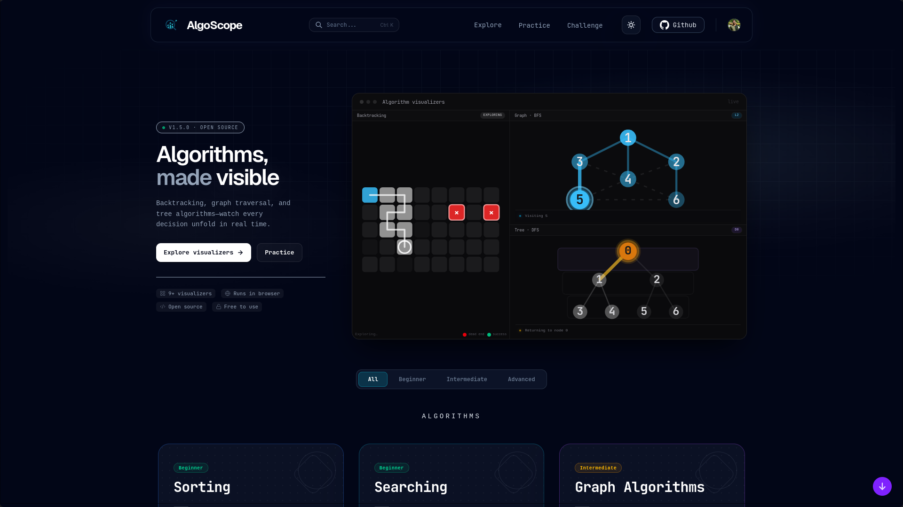

<div align="center">

<!-- Minimal Sleek Banner with Gruvbox Palette -->


<!-- Distinctive Modern Typography Intro (Syne Font) -->
<a href="https://git.io/typing-svg">
  
</a>

<!-- Quick Tag Badges -->
<p align="center">
  
  
  
  
  
</p>

<!-- Social Links -->
<p align="center">
  <a href="https://bimbok-portfolio.vercel.app/" target="_blank">
    
  </a>
  &nbsp;
  <a href="https://www.linkedin.com/in/bratik-mukherjee/" target="_blank">
    
  </a>
  &nbsp;
  <a href="mailto:bimbokmkj@gmail.com">
    
  </a>
</p>

</div>

---

### ⚡ The Craft

> Build across the entire abstraction stack—from bare-metal bootloaders and terminal interfaces to scalable web ecosystems—obsessed with how software actually thinks and breathes beneath the surface. Driven by the quiet satisfaction of turning complex logic into fast, intentional, and resilient tools.

---

### 🖥️ Terminal Overview

```zsh
❯ whoami
bratik_mukherjee — Systems & Full-Stack Engineer

❯ current_focus
building AlgoScope (algorithm visualizer) · exploring Linux internals & eBPF

❯ workflow
Neovim (LazyVim) + Tmux + Zsh on Arch Linux

❯ mantra
"Readable architecture before clever tricks, automated end-to-end."
```

---

### 🛠️ Tech Stack & Tooling

<p align="center">
  <a href="https://skillicons.dev">
    
  </a>
</p>

---

### 🚀 Featured Projects

<table align="center" width="100%">
  <tr>
    <td width="50%" valign="top">
      <div align="center">
        <h3>🌊 <a href="https://algo-scope-virid.vercel.app">AlgoScope</a></h3>
        <p><i>High-fidelity algorithm visualizer turning static code into fluid motion.</i></p>
        <p>
          
          
          
        </p>
        <a href="https://algo-scope-virid.vercel.app" target="_blank">
          
        </a>
      </div>
    </td>
    <td width="50%" valign="top">
      <div align="center">
        <h3>🌸 <a href="https://github.com/Bimbok/sizuka">Sizuka Language</a></h3>
        <p><i>Custom JVM language with recursive descent parsing and AST interpretation.</i></p>
        <p>
          
          
        </p>
        <a href="https://github.com/Bimbok/sizuka" target="_blank">
          
        </a>
      </div>
    </td>
  </tr>
</table>

<div align="center">

#### 📝 Technical Writing
[📖 Configuring Neovim with LazyVim](https://github.com/Bimbok/nvim) &nbsp;·&nbsp; [🐚 Understanding Shell Internals](https://github.com/Bimbok/myshell)

</div>

---

### 📊 Telemetry & Activity

<p align="center">
  
  &nbsp;
  
</p>

<p align="center">
  
</p>

---

<div align="center">

<p>
  💼 <b>Open for Opportunities:</b> Actively seeking Full-Stack, Systems, and DevOps roles.<br/>
  Let's connect via <a href="mailto:bimbokmkj@gmail.com"><b>Email</b></a> or <a href="https://www.linkedin.com/in/bratik-mukherjee/"><b>LinkedIn</b></a>.
</p>

<sub>Built with Gruvbox dark aesthetic · Clean, fast & minimal</sub>

</div>
