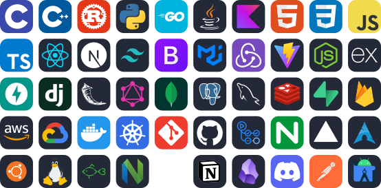

<h1 align="center"></h1>

<table align="center" width="780">
  <tr>
    <td align="center" valign="middle" width="160">
      
    </td>
    <td align="left" valign="middle" width="620">
      <i>Build across the entire abstraction stack—from bare-metal bootloaders and terminal interfaces to scalable web ecosystems—obsessed with how software actually thinks and breathes beneath the surface. Driven by the quiet satisfaction of turning complex logic into fast, intentional, and resilient tools.</i>
    </td>
  </tr>
</table>

 

<h3 align="center">Tech Stack</h3>

<table align="center" width="780">
  <tr>
    <td align="center" valign="middle" width="530">
      
    </td>
    <td align="center" valign="middle" width="250">
      
    </td>
  </tr>
</table>

 

